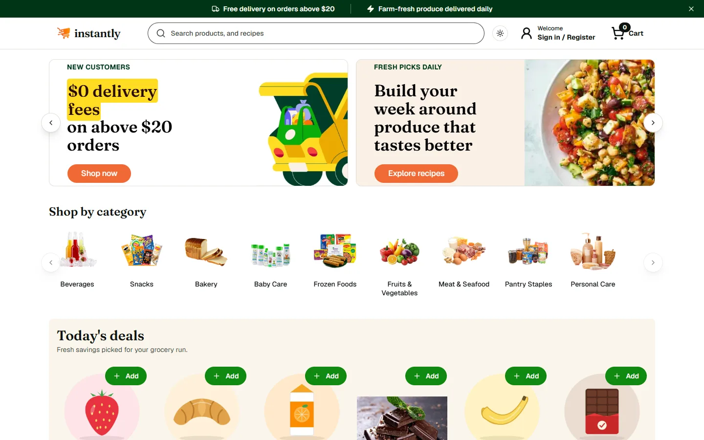
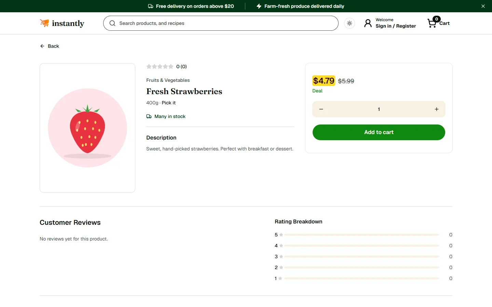
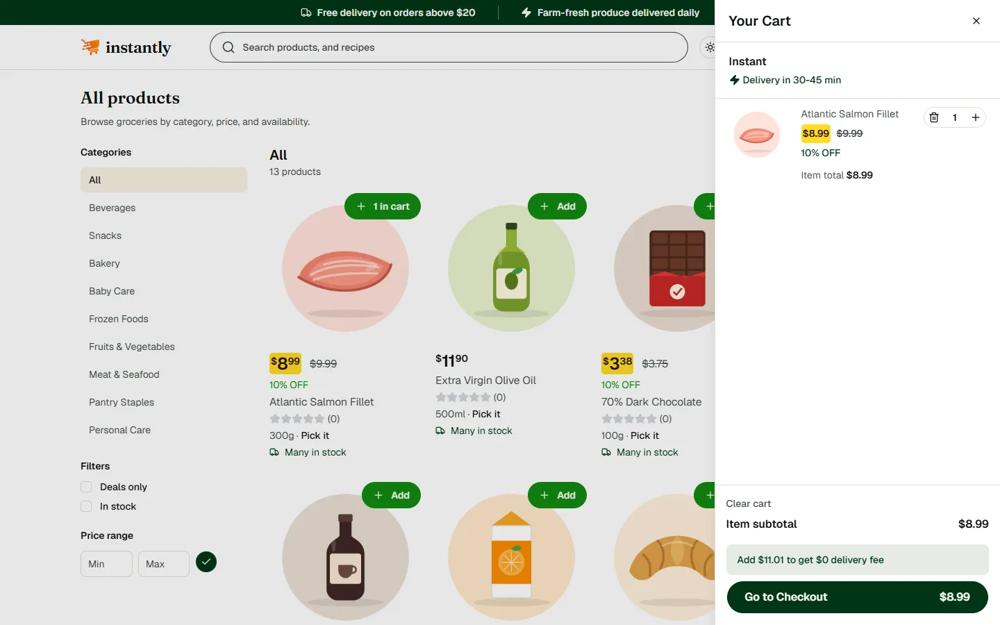
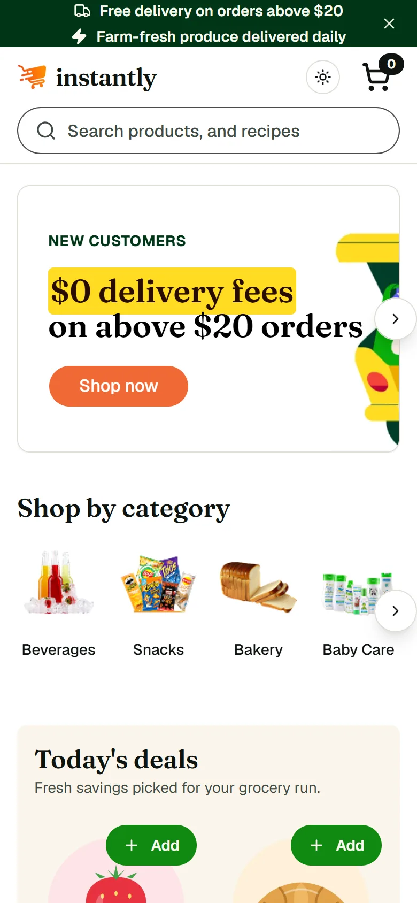

# 🛒 AI Ecommerce Platform: MERN Stack

A full-stack ecommerce platform with guest & authenticated carts, product catalog with AI-assisted content tools, Stripe checkout, order tracking, ratings & reviews, and an admin dashboard with analytics.

> Built on top of an open-source MERN ecommerce starter, extended and deployed independently.

**Live demo:** https://ai-ecom-mocha.vercel.app (API on Render's free tier; the first request after a long idle can take up to a minute while it wakes up)

| Home | Product page |
|---|---|
|  |  |

| Catalog and cart | Mobile |
|---|---|
|  |  |

---

## 🧠 Engineering highlights

- **Idempotent payments.** The Stripe webhook uses atomic compare-and-set on `paymentStatus`, so a replayed event cannot double-decrement stock or flip a paid order to cancelled. Covered by tests.
- **No overselling.** Orders re-check stock server-side and decrement with a guarded update, so stock never goes negative under concurrent checkouts.
- **Server-side pricing.** Prices, tax and delivery fees are always computed on the server from the database, never trusted from the client.
- **Hardened API.** Helmet, rate limiting (stricter on auth and AI routes), body size limits, escaped regex search, consistent 4xx errors for bad input, httpOnly cookies, and role-based admin guards.
- **Tested.** Vitest + Supertest on an in-memory MongoDB (24 tests) plus client unit tests. CI runs typecheck, lint, tests and the production build on every push.
- **Fast front end.** Route-level code splitting, lazy-loaded cart/auth overlays, WebP assets, self-hosted fonts and a stable layout. Lighthouse on the live site: **desktop 98**, mobile 60 (throttled), CLS 0.006.
- **Typed end to end.** Strict TypeScript with zero `any` on the client and a typed API layer.
- **Accessible and responsive.** Labelled controls, keyboard-friendly dialogs and layouts checked from 320px to 1440px.

The full audit log, with before/after metrics, is in [`docs/AUDIT_CHANGELOG.md`](docs/AUDIT_CHANGELOG.md).

---

## ✨ Features

- 🔐 JWT (cookie-based) authentication
- 🛒 Guest cart with auto-merge on login
- 🛍️ Full shopping cart & checkout flow
- 📦 Product catalog: categories, search, filtering, sorting, pagination
- 🖼️ Image uploads via AWS S3
- ⭐ Ratings & reviews (verified purchase only)
- 💳 Stripe Checkout + webhook-based payment confirmation
- 📍 Saved shipping addresses
- 📦 Order placement, tracking, and status updates
- 👨‍💼 Admin dashboard: products, orders, analytics
- 🤖 AI-assisted admin tools (product title rewrite & description generation)

## 🏗️ Tech Stack

**Frontend:** React 19, TypeScript, Vite, Tailwind CSS v4, shadcn/ui, Zustand
**Backend:** Node.js, Express 5, MongoDB (Mongoose), JWT, Passport
**Integrations:** Stripe, AWS S3, Vercel AI SDK (Gemini)

---

## 📁 Project Structure

```
AI-Ecom/
├── backend/     # Express API server
└── client/      # React frontend (Vite)
```

---

## 🚀 Local Setup

### 1. Prerequisites
- Node.js 18+
- A MongoDB database (local or [MongoDB Atlas](https://www.mongodb.com/cloud/atlas) free tier)
- A [Stripe](https://dashboard.stripe.com/register) account (test mode is fine)
- An [AWS](https://aws.amazon.com) account with an S3 bucket (free tier)
- A [Vercel AI Gateway](https://vercel.com/docs/ai-gateway) API key (for the AI admin tools)

### 2. Backend

```bash
cd backend
npm install
cp .env.example .env
# fill in the values in .env: see table below
npm run seed:categories   # optional: seeds initial categories
# optional: create/promote a demo admin so you can open the admin dashboard
DEMO_ADMIN_EMAIL=admin@example.com DEMO_ADMIN_PASSWORD='choose-a-password' npm run seed:demo-admin
# optional: add 12 sample products (safe to re-run; needs the categories and demo admin above)
DEMO_ADMIN_EMAIL=admin@example.com npm run seed:demo-products
npm run dev
```

### 3. Frontend

```bash
cd client
npm install
cp .env.example .env
# set VITE_BASE_API_URL to your backend URL
npm run dev
```

The app will be available at `http://localhost:5173`, with the API at `http://localhost:8000`.

---

## 🔑 Environment Variables

### Backend (`backend/.env`)

| Variable | Description |
|---|---|
| `NODE_ENV` | `development` or `production` |
| `PORT` | Port for the API server (e.g. `8000`) |
| `MONGO_URI` | MongoDB connection string |
| `JWT_SECRET` | Any long random string, used to sign auth tokens |
| `JWT_EXPIRES_IN` | Token lifetime, e.g. `7d` |
| `STRIPE_SECRET_KEY` | From Stripe Dashboard → Developers → API keys |
| `STRIPE_WEBHOOK_SECRET` | From Stripe Dashboard → Developers → Webhooks (see below) |
| `AWS_REGION` | AWS region your S3 bucket is in, e.g. `us-east-1` |
| `AWS_ACCESS_KEY_ID` | From an IAM user with S3 access |
| `AWS_SECRET_ACCESS_KEY` | From the same IAM user |
| `AWS_S3_BUCKET_NAME` | Name of the S3 bucket used for product images |
| `FRONTEND_ORIGIN` | URL of your deployed frontend (for CORS) |
| `AI_GATEWAY_API_KEY` | From [Vercel AI Gateway](https://vercel.com/docs/ai-gateway), powers the AI admin tools |

### Frontend (`client/.env`)

| Variable | Description |
|---|---|
| `VITE_BASE_API_URL` | Base URL of the backend API, e.g. `http://localhost:8000/api/` |

---

## ☁️ Deployment

See [`DEPLOYMENT.md`](./DEPLOYMENT.md) for full step-by-step deployment instructions (backend on Render, frontend on Vercel, Stripe webhook setup, and post-deploy checklist).

---

## 🧪 Testing

```bash
cd backend && npm test        # Vitest + Supertest on an in-memory MongoDB (no external services)
cd client  && npm test        # Vitest unit tests
cd client  && npm run lint && npm run build
```

Backend tests live in `backend/src/__tests__/` and cover auth, authorization (401/403), product search (including regex-injection safety), checkout/stock rules and Stripe-webhook idempotency. Stripe is mocked; MongoDB runs in memory via `mongodb-memory-server` (the first run downloads a mongod binary).

> The older files in `backend/src/tests/` are manual smoke scripts that call a **deployed** URL with `fetch`. They are not part of `npm test`.

CI (`.github/workflows/ci.yml`) runs typecheck, lint, tests and the production build on every push and pull request.
